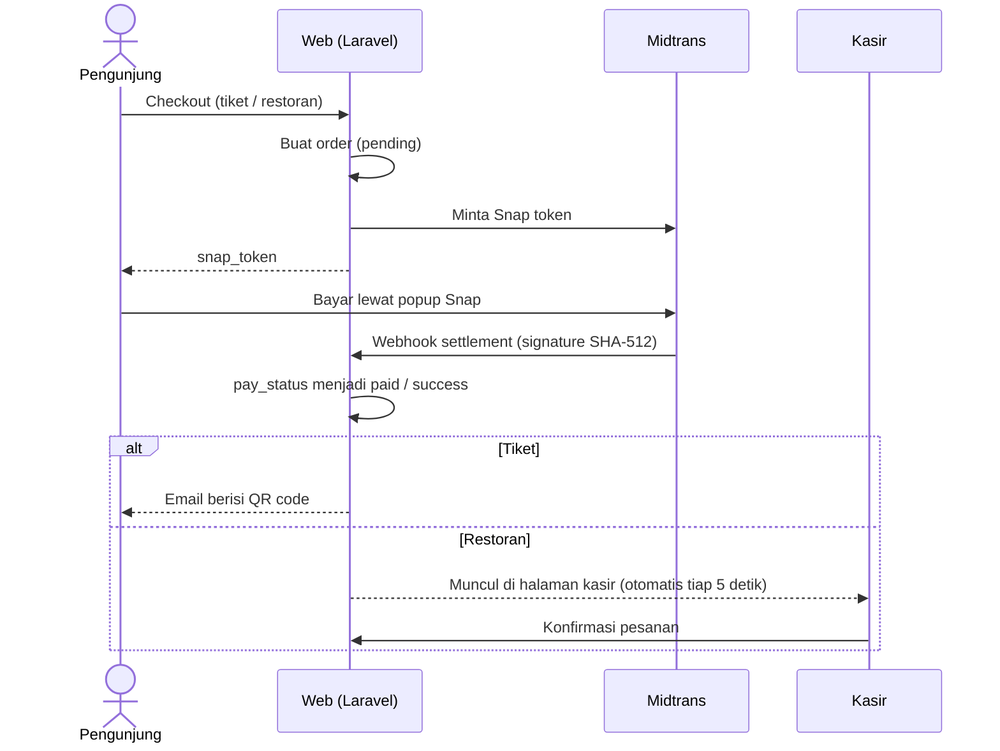
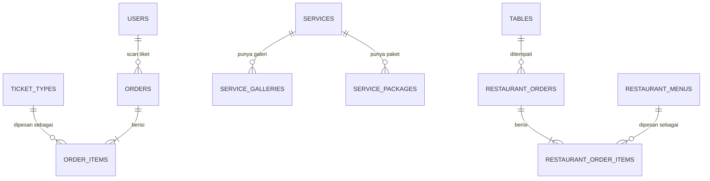

# 🌿 Sendangku — Platform Wisata Sendang Kun Gerit

Platform web terpadu untuk destinasi wisata **Sendang Kun Gerit**. Pengunjung dapat melihat informasi destinasi, **membeli tiket online tanpa akun**, **memesan makanan dan membayar langsung dari meja**, serta **memesan layanan lewat WhatsApp**. Pengelola memiliki back-office multi-peran untuk mengurus tiket, restoran, dan konten website.


> **Catatan:** proyek ini dibuat sebagai **bahan portofolio** dan memakai **Midtrans Sandbox**, sehingga tidak diperuntukkan bagi transaksi sungguhan.

---

## 📑 Daftar Isi

- [Fitur](#-fitur)
- [Peran & Hak Akses](#-peran--hak-akses)
- [Alur Aplikasi](#-alur-aplikasi)
- [Pembayaran & QR Tiket](#-pembayaran--qr-tiket)
- [Aturan Bisnis](#-aturan-bisnis)
- [Tugas Terjadwal](#-tugas-terjadwal)
- [Skema Database](#-skema-database)
- [Routing](#-routing)
- [Teknologi](#-teknologi)
- [Struktur Proyek](#-struktur-proyek)
- [Menjalankan di Lokal](#-menjalankan-di-lokal)

---

## ✨ Fitur

### 🌐 Website Publik *(tanpa login)*

**Beranda** (`/`) — satu halaman dengan section yang tertaut dari navbar:
- Hero dengan tombol **Beli Tiket Sekarang**
- Tentang Kami
- Layanan 
- Fasilitas
- Berita (3 artikel terbaru)
- Kontak: Google Maps, tombol WhatsApp, dan Instagram

**Layanan** (`/layanan`, `/layanan/{slug}`)
- Katalog layanan dengan galeri foto dan paket harga
- Paket diurutkan: **populer** dulu, lalu harga termurah
- Tombol **Pesan via WhatsApp** per paket: nomor tujuan dan isi pesan diatur per paket, pesan di-URL-encode

**Tiket Online** (`/checkout/ticket`)
- Pilih satu atau beberapa jenis tiket sekaligus (mis. 2 Terusan + 1 Normal) dengan jumlah masing-masing
- Isi nama, email, dan nomor HP pembeli
- Bayar lewat popup **Midtrans Snap**, lalu diarahkan ke halaman "Pembayaran Berhasil"
- **QR code dikirim otomatis ke email** pembeli

**Pesan Makanan** (`/restourant`)
- Menampilkan menu yang tersedia, dikelompokkan per kategori
- Isi nama pemesan, **pilih nomor meja dari dropdown**, pilih menu dan jumlah, tambahkan catatan (opsional)
- Bayar lewat popup **Midtrans Snap**; setelah sukses, kode order ditampilkan
- Harga dan total selalu dihitung di server dari database

**Blog** (`/blog`, `/blog/{slug}`)
- Daftar artikel (9 per halaman) dan halaman detail dengan 3 artikel terkait
- Slug dibuat otomatis dari judul

---

### 🎟️ Modul Tiket *(Petugas Tiket & Admin)*

**Dashboard Tiket** (`/admin/order-ticket`)
- Filter periode: **Hari Ini / Minggu Ini / Bulan Ini / Semua Waktu**
- Total pendapatan, jumlah tiket **terscan** dan **belum terscan**, total pengunjung
- Rincian jumlah per jenis tiket
- Tabel transaksi dengan filter **status** (`active` / `used`) dan **metode** (`online` / `offline`)

**Scan QR** (`/admin/order-ticket/scan`)
- Pemindaian lewat **kamera** perangkat
- Hasil verifikasi:
  - ✅ **Valid** — tiket ditandai terpakai, mencatat waktu scan dan petugas, menampilkan rincian jenis dan jumlah tiket
  - ⚠️ **Sudah digunakan** — menampilkan waktu pemakaian sebelumnya
  - ❌ **Tidak ditemukan** atau format QR tidak valid

**Tiket Offline** (`/admin/order-ticket/create`)
- Petugas memilih jenis dan jumlah tiket untuk pengunjung yang membeli di lokasi
- Tiket langsung tercatat lunas dan terpakai, lengkap dengan waktu dan petugas yang mencatat

**Jenis Tiket** (`/admin/ticket-type`)
- CRUD jenis tiket: nama, harga, dan benefit

---

### 🍽️ Modul Restoran & Kasir *(Kasir & Admin)*

**Halaman Kasir** (`/admin/restaurant-orders/kasir`)
- Menampilkan pesanan yang **sudah dibayar dan belum dikonfirmasi**: kode order, nama, meja, catatan, rincian item, total, dan waktu
- **Pembaruan otomatis (Pooling) tiap 5 detik** dan **notifikasi suara**
- Tombol **Konfirmasi** untuk menandai pesanan sudah diterima kasir

**Dashboard Restoran** (`/admin/restaurant-order`)
- Filter periode dan filter konfirmasi (Semua / Belum / Sudah)
- Total pendapatan, jumlah transaksi, dan jumlah item terjual per kategori (makanan, minuman, lainnya)
- Tabel transaksi lengkap dengan meja dan item pesanan
- Badge jumlah pesanan yang belum dikonfirmasi

**Pesanan Offline** (`/admin/restaurant-order/create`)
- Kasir memilih menu dan jumlah (plus catatan) untuk pelanggan yang membayar di tempat
- Pesanan langsung tercatat lunas dan terkonfirmasi

**Menu** (`/admin/restaurant-menu`)
- CRUD menu: nama, kategori (`makanan` / `minuman` / `lainnya`), harga, foto, dan status **tersedia/habis**
- Pencarian berdasarkan nama

**Meja** (`/admin/table`)
- CRUD meja berdasarkan nomor meja (unik); kode meja dibuat otomatis

---

### 💬 Booking Layanan via WhatsApp
- Setiap paket layanan memiliki **nomor WhatsApp** dan **template pesan** sendiri
- Pengunjung menekan tombol dan langsung masuk ke chat WhatsApp dengan pesan yang sudah terisi

---

### 🛡️ Admin

**Dashboard** (`/admin/dashboard`) dengan filter periode:
- Total pendapatan beserta rincian **tiket** dan **restoran**
- Total pengunjung dan perbandingan tiket **online vs offline** (jumlah dan persentase)
- Grafik pengunjung **minggu berjalan** (Senin–Minggu)

**Kelola konten**

| Konten | Yang bisa dikelola |
|---|---|
| Layanan | Nama, deskripsi, harga, durasi, thumbnail, galeri (maks. 5 foto) |
| Paket layanan | Judul, harga, benefit, pesan & nomor WhatsApp, penanda populer |
| Blog | Judul, thumbnail, konten |

**Manajemen user staf** (`/admin/user`)
- Tambah, ubah, dan hapus akun staf dengan peran `admin`, `tiket`, atau `kasir`
- Ringkasan jumlah anggota, kasir, dan petugas tiket
- Saat mengubah akun, password boleh dikosongkan bila tidak ingin diganti

---

## 🔐 Peran & Hak Akses

| Area | URL (prefix `/admin`) | Admin | Kasir | Petugas Tiket |
|---|---|:-:|:-:|:-:|
| Dashboard agregat | `/dashboard` | ✅ | — | — |
| Manajemen user staf | `/user` | ✅ | — | — |
| Blog | `/blog` | ✅ | — | — |
| Layanan & paket | `/service`, `/service-package` | ✅ | — | — |
| Menu restoran | `/restaurant-menu` | ✅ | ✅ | — |
| Meja | `/table` | ✅ | ✅ | — |
| Dashboard restoran & pesanan offline | `/restaurant-order` | ✅ | ✅ | — |
| Halaman kasir (konfirmasi) | `/restaurant-orders/kasir` | ✅ | ✅ | — |
| Dashboard tiket & tiket offline | `/order-ticket` | ✅ | — | ✅ |
| Scan QR | `/order-ticket/scan` | ✅ | — | ✅ |
| Jenis tiket | `/ticket-type` | ✅ | — | ✅ |

Setelah login, pengguna diarahkan sesuai perannya: admin ke `/admin/dashboard`, kasir ke `/admin/restaurant-order`, petugas tiket ke `/admin/order-ticket`.

---

## 🔄 Alur Aplikasi

### Pembayaran online (tiket & restoran)



### Tiket
```
Beranda → Beli Tiket → pilih jenis & jumlah → isi data pembeli
→ bayar (Midtrans Snap) → QR dikirim ke email
→ tiba di lokasi, tunjukkan QR → petugas scan → masuk ✅
```

### Pesan makanan
```
/restourant → isi nama, pilih meja, pilih menu & jumlah
→ bayar (Midtrans Snap) → pesanan muncul di halaman kasir + bunyi notifikasi
→ kasir konfirmasi → makanan diantar ke meja ✅
```

### Booking layanan
```
/layanan → pilih layanan → pilih paket → Pesan via WhatsApp
→ chat WhatsApp terbuka dengan pesan terisi ✅
```

### Pesanan & tiket offline
```
Kasir  : Pesanan Offline → pilih menu & jumlah → simpan (langsung lunas & terkonfirmasi)
Tiket  : Tiket Offline   → pilih jenis & jumlah → simpan (langsung lunas & terpakai)
```

### Status

| Entitas | Kolom | Alur | Arti |
|---|---|---|---|
| Order tiket | `pay_status` | `pending` → `paid` / `failed` | Status pembayaran |
| Order tiket | `status` | `active` → `used` | Status pemakaian tiket |
| Order restoran | `pay_status` | `pending` → `success` / `failed` | Status pembayaran |
| Order restoran | `confirmed` | `false` → `true` | Sudah diperiksa kasir |

---

## 💳 Pembayaran & QR Tiket

### Midtrans
- Pembayaran tiket dan restoran memakai **Midtrans Snap**
- Server membuat order dan Snap token; `order_id` Midtrans sama dengan kode order, masa berlaku pembayaran **60 menit**, dan rincian item diambil dari harga di database
- **Webhook** (`POST /api/midtrans/callback`):
  - Memverifikasi **signature SHA-512** (`order_id + status_code + gross_amount + server_key`)
  - `settlement` → order tiket menjadi `paid`, order restoran menjadi `success`
  - `expire`, `cancel`, `deny`, `failure` → `failed` (hanya untuk order yang masih `pending`)
  - Pembaruan bersifat **idempoten**, sehingga email tiket hanya terkirim sekali
- Rate limit checkout tiket dan restoran: **5 permintaan per menit per IP**


### QR Tiket
- Setiap order memiliki `qr_token` berupa **UUID** unik
- Setelah pembayaran berhasil, sistem membuat gambar **PNG 300 px** dari token, menyimpannya di `storage/app/public/qrcodes/`, lalu menyertakannya di **email konfirmasi** (kode order, total bayar, rincian tiket, dan QR)
- Satu order yang berisi beberapa jenis tiket memakai **satu QR**; sekali scan, seluruh order berstatus terpakai

---

## 📏 Aturan Bisnis

**Tiket**
- Pembelian online berupa **guest checkout**: tanpa akun, bukti tiket dikirim ke email
- Satu order dapat berisi beberapa jenis tiket
- Harga diambil dari jenis tiket saat order dibuat dan disimpan sebagai snapshot di rincian order
- Harga tetap, tanpa tanggal kunjungan; tiket berlaku sampai dipindai
- Tiket **sekali pakai**: scan pertama mengubah status menjadi terpakai, lengkap dengan waktu dan petugas
- Tiket offline langsung tercatat lunas dan terpakai
- Dashboard hanya menghitung order yang sudah **dibayar**

**Restoran**
- Hanya menu berstatus **tersedia** yang dapat dipesan
- Harga dan total dihitung server; harga disimpan sebagai snapshot di item pesanan
- Pesanan tampil di kasir hanya jika **sudah dibayar** dan **belum dikonfirmasi**
- Pesanan offline dari kasir langsung lunas dan terkonfirmasi
- Pelanggan tidak memerlukan akun; hanya nama pemesan dan nomor meja yang dicatat

**Unggahan**

| Konten | Format | Ukuran maks. |
|---|---|---|
| Thumbnail blog, menu, layanan | jpg, jpeg, png, webp | 2 MB |
| Galeri layanan | jpg, jpeg, png, webp | 5 MB per foto, maks. 5 foto |

Saat galeri layanan diperbarui dengan foto baru, seluruh galeri lama diganti.

---

## ⏰ Tugas Terjadwal

| Perintah | Jadwal | Fungsi |
|---|---|---|
| `orders:expire` | Tiap jam | Order tiket dan restoran berstatus `pending` lebih dari 25 jam diubah menjadi `failed` |
| `orders:cleanup` | Harian | Order tiket dan restoran berstatus `failed` lebih dari 1 bulan dihapus |

---

## 🗄️ Skema Database



```sql
-- Akun staf
users (
  id, name, email, password,
  role ENUM('admin','tiket','kasir') DEFAULT 'tiket',
  created_at, updated_at
)

-- Tiket
ticket_types (
  id, name, price, benefit TEXT NULL,
  created_at, updated_at
)

orders (
  id,
  order_code VARCHAR UNIQUE NULL,
  qr_token UUID UNIQUE,
  qr_path TEXT NULL,
  buyer_name, buyer_phone, buyer_email  VARCHAR NULL,
  total_price INT DEFAULT 0,
  status ENUM('active','used') DEFAULT 'active',
  pay_status ENUM('pending','paid','failed') DEFAULT 'pending',
  snap_token VARCHAR NULL,
  purchase ENUM('online','offline'),
  scanned_at TIMESTAMP NULL,
  scanned_by → users NULL,
  created_at, updated_at
)

order_items (
  id, order_id → orders, ticket_type_id → ticket_types NULL,
  qty, price, subtotal,
  created_at, updated_at
)

-- Layanan
services (
  id, slug UNIQUE, name, description TEXT,
  price, duration, thumbnail,
  created_at, updated_at
)

service_galleries (
  id, service_id → services, image,
  created_at, updated_at
)

service_packages (
  id, service_id → services,
  title, price, benefit TEXT,
  whatsapp_message, whatsapp_number,
  populer BOOLEAN DEFAULT false,
  created_at, updated_at
)

-- Blog
blogs (
  id, name, slug UNIQUE, thumbnail, content TEXT,
  created_at, updated_at
)

-- Restoran
restaurant_menus (
  id, status BOOLEAN DEFAULT true,
  category ENUM('makanan','minuman','lainnya'),
  name, thumbnail, price,
  created_at, updated_at
)

tables (
  id, number UNIQUE, table_code UNIQUE,
  created_at, updated_at
)

restaurant_orders (
  id,
  order_code VARCHAR UNIQUE,
  name, table_id → tables NULL, note TEXT NULL,
  total_price, snap_token VARCHAR NULL,
  pay_status ENUM('pending','success','failed') DEFAULT 'pending',
  confirmed BOOLEAN DEFAULT false,
  payment ENUM('offline','online') DEFAULT 'online',
  created_at, updated_at
)

restaurant_order_items (
  id, restaurant_order_id → restaurant_orders,
  restaurant_menu_id → restaurant_menus NULL,
  qty, price, subtotal,
  created_at, updated_at
)
```

Tabel pendukung Laravel: `sessions`, `cache`, dan `jobs`. Kolom `price` dan `subtotal` di rincian order adalah **snapshot** harga saat transaksi, sehingga riwayat tidak berubah ketika harga di-update.

---

## 🧭 Routing

**Publik**

| Method | URL | Fungsi |
|---|---|---|
| GET | `/` | Beranda |
| GET | `/layanan`, `/layanan/{slug}` | Daftar dan detail layanan |
| GET | `/blog`, `/blog/{slug}` | Daftar dan detail blog |
| GET / POST | `/checkout/ticket` | Halaman checkout / membuat order dan Snap token |
| GET | `/checkout/ticket/success` | Halaman sukses pembayaran tiket |
| GET / POST | `/restourant` | Halaman pesan makanan / membuat order dan Snap token |
| GET / POST | `/login`, POST `/logout` | Autentikasi staf |
| POST | `/api/midtrans/callback` | Webhook Midtrans |

**Khusus kasir (di bawah `/admin`)**

| Method | URL | Fungsi |
|---|---|---|
| GET | `/restaurant-orders/waiting-ids` | Daftar ID pesanan yang menunggu konfirmasi (dipakai pembaruan otomatis) |
| GET | `/restaurant-orders/unconfirmed` | Daftar lengkap pesanan yang menunggu konfirmasi |
| PATCH | `/restaurant-order/{id}/confirm` | Konfirmasi pesanan |

**Khusus petugas tiket (di bawah `/admin`)**

| Method | URL | Fungsi |
|---|---|---|
| POST | `/order-ticket/verify` | Verifikasi QR tiket |

---

## 🧱 Teknologi

| Layer | Teknologi |
|---|---|
| Backend | PHP 8.3+, Laravel 13 |
| Frontend | Blade, Alpine.js 3, Tailwind CSS v4, Vite |
| Database | MySQL |
| Pembayaran | Midtrans Snap (`midtrans/midtrans-php`) |
| QR Code | `simplesoftwareio/simple-qrcode` (membuat QR), `html5-qrcode` (scan kamera) |
| Slug | `spatie/laravel-sluggable` |
| Pustaka UI (CDN) | AOS, Swiper, GLightbox, Lucide, Chart.js |
| Autentikasi | Session auth dengan middleware peran (`role:`) |
| Penyimpanan | Disk `public` Laravel (`menu`, `blog`, `service`, `gallery`, `qrcodes`) |
| Queue, session, cache | Driver `database` |
| Pengujian & gaya kode | Pest, Pint |

---

## 🗂️ Struktur Proyek

```
app/
├── Console/Commands/        # orders:expire, orders:cleanup
├── Http/
│   ├── Controllers/
│   │   ├── Admin/           # dashboard, tiket, restoran, meja, layanan, blog, user
│   │   ├── Public/          # beranda, layanan, blog, checkout tiket, pesan makanan
│   │   └── Webhook/         # callback Midtrans
│   ├── Middleware/          # AuthValidation (peran)
│   └── Requests/            # validasi form per fitur
├── Mail/                    # OrderConfirmationMail
├── Models/
└── Services/                # MidtransService, UserOrderService, RestourantService
database/
├── migrations/
└── seeders/                 # akun demo
resources/
├── views/
│   ├── admin/               # dashboard & CRUD staf
│   ├── front/               # halaman publik
│   ├── components/ layouts/ emails/
├── css/ js/
routes/
├── web.php                  # halaman publik & area admin
├── api.php                  # webhook Midtrans
└── console.php              # jadwal tugas
```

---

## 🚀 Menjalankan di Lokal

### Prasyarat
- PHP **8.3+** dengan ekstensi `pdo_mysql` dan `imagick` (untuk membuat gambar QR)
- Composer
- Node.js dan npm
- MySQL

### Instalasi

```bash
# 1. Ambil kode dan pasang dependensi
git clone https://github.com/mrzcyber/Sendangku.git
cd Sendangku
composer install
npm install

# 2. Siapkan environment
cp .env.example .env
php artisan key:generate

# 3. Buat database MySQL bernama "sendangku" (atau sesuaikan DB_* di .env),
#    lalu jalankan migrasi dan seeder
php artisan migrate --seed

# 4. Hubungkan folder storage (foto upload dan gambar QR)
php artisan storage:link

# 5. Jalankan
composer dev
# atau manual, di dua terminal: php artisan serve  dan  npm run dev
```

> Di Windows, `composer dev` dapat gagal karena `php artisan pail` membutuhkan ekstensi `pcntl`. Gunakan cara manual jika itu terjadi.

Buka `http://127.0.0.1:8000`.

### Konfigurasi `.env`

Tambahkan key Midtrans Sandbox (dari dashboard Midtrans Sandbox, diawali `SB-`):

```env
APP_URL=http://127.0.0.1:8000

MIDTRANS_SERVER_KEY=SB-Mid-server-xxxxxxxx
MIDTRANS_CLIENT_KEY=SB-Mid-client-xxxxxxxx
MIDTRANS_IS_PRODUCTION=false
```

Bawaan `MAIL_MAILER=log` menulis email konfirmasi ke `storage/logs/laravel.log`. Untuk melihatnya di inbox, arahkan variabel `MAIL_*` ke layanan SMTP uji seperti Mailtrap.

### Akun demo

| Peran | Email | Password |
|---|---|---|
| Admin | `admin@example.com` | `password` |
| Petugas Tiket | `tiket@example.com` | `password` |
| Kasir | `kasir@example.com` | `password` |

Login di `/login`.

### Mencoba pembayaran

Agar status pesanan berubah setelah pembayaran, Midtrans perlu dapat menghubungi aplikasi:

1. Jalankan tunnel ke aplikasi lokal (misalnya ngrok atau Cloudflare Tunnel).
2. Di pengaturan dashboard Midtrans Sandbox, isi **Payment Notification URL** dengan `https://<alamat-tunnel>/api/midtrans/callback`.
3. Lakukan checkout, lalu selesaikan pembayaran lewat popup Snap atau Midtrans Payment Simulator.

### Tugas terjadwal

```bash
php artisan schedule:work
```

### Pengujian

```bash
composer test
```

Menggunakan Pest dengan SQLite in-memory.

---

## 👤 Pembuat

Dibuat oleh **Reza** ([@mrzcyber](https://github.com/mrzcyber)) sebagai proyek portofolio web development.